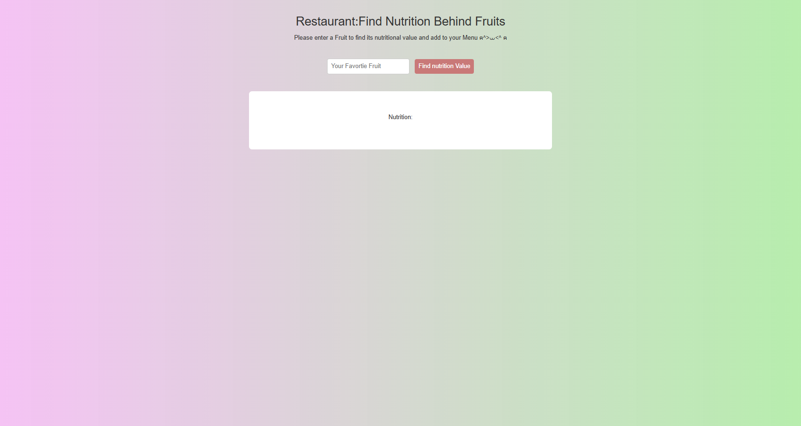

# Restaurant — Fruit Nutrition Lookup

🌐 **Live Demo:** https://kinzarehman.github.io/simple-api-restaurant/

## What I built

A front-end app for someone working at or managing a restaurant that looks up nutrition information for a fruit, so staff can answer menu and ingredient questions quickly.

## How it works

1. Type a fruit name and click Submit.
2. The app calls the Fruityvice API for that fruit.
3. It shows the fruit's name, family, and genus, plus its nutrition per serving: calories, carbohydrates, fat, protein, and sugar.

## Limits

- Search is case-sensitive, so type the fruit name in lowercase (for example, `banana`).

## View

  
  

## Limits 
-Search fruit, the test is case sensitive 
## Built With

- HTML5
- CSS3
- Vanilla JavaScript

## Local Preview

Open `index.html` using the VS Code Live Server extension or open the file directly in your browser.

## Before Publishing

This is an opensource APi, test and read the documentation.
