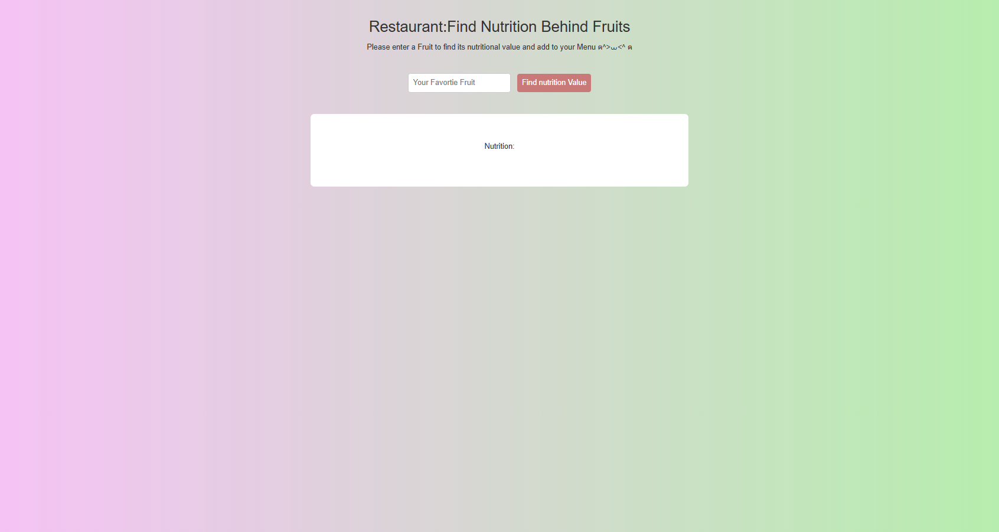

# Resturant 
Goal: Build a simple front-end app that displays data returned from an api that would be beneficial to someone working at or managing a restaurant.

[Live](https://kinzarehman.github.io/simple-api-restaurant/)

## View

  
  

## Limits 
-Search fruit, the test is case sensitive 
## Built With

- HTML5
- CSS3
- Vanilla JavaScript

## Local Preview

Open `index.html` using the VS Code Live Server extension or open the file directly in your browser.

## Before Publishing

This is an opensource APi, test and read the documentation.
